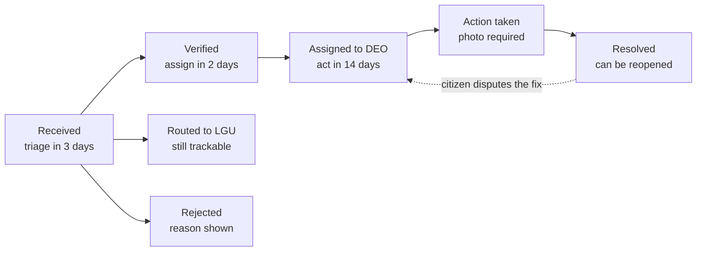

# Ghostbusters: Product Spec

Oct 19, 2026 · @Ivan

## Overview

Ghostbusters is Google Maps for public works, where every report gets a tracking number. It redesigns the citizen side of the DPWH Transparency Portal around two questions: what is being built near me, and what happened to my report.

**The problem.** The current portal is organized the way DPWH stores data. It opens on national totals, names projects like procurement records, hides the map inside a project's Location tab, and only lets you report on a project that already exists. After a citizen submits a report, nothing comes back. "I reported and heard nothing" is the main complaint.

**Citizen goals**

- A resident can find every ongoing project near them in under 30 seconds, without knowing a contract ID.
- Every report gets a reference number and a visible status until it is resolved.
- Problems with no existing project (a pothole, a collapsed drainage) can be reported by dropping a pin.
- DPWH staff can triage reports without reading each one by hand.

**DPWH goals**

- Inspectors see every project and open issue in their district on one map and plan a day's site visits as a route.
- Triage load drops because duplicate reports are clustered into one issue.
- Supervisors see where projects are delayed or reports pile up, by district.
- Dated, location-stamped inspection photos are attached to each project record, which supports audits.
- Citizen reports flag problems on ongoing projects before completion and final payment to the contractor.

**Non-goals**

- Replacing DPWH's project database. Ghostbusters reads from it.
- Procurement analysis or contractor scoring. Documents stay one tap away, but this is not an audit tool.
- Fixing LGU-owned roads. We route those reports and say so plainly, but DPWH is not accountable for them.

## Users

Citizens are the primary user; three staff roles exist so their reports get acted on.

| User | What they need | Main screens |
| --- | --- | --- |
| Citizen | See projects near them, report a problem, follow up | Map, project card, report form, My Reports |
| DPWH triage staff (Office of the Secretary) | Sort incoming reports, merge duplicates, route to the right office | Triage queue |
| District Engineering Office (DEO) | Act on assigned reports, post updates and photos | Assigned queue, ticket detail |
| LGU contact (city, municipal, barangay) | Receive reports about roads they own | Email digest or simple inbox (phase 2) |

## Citizen experience

The app opens on a map of where the user is, not on national statistics. References: Google Maps for search, the place sidebar and contributions; Airbnb for the list that follows the map and pins that carry information.

### Map home

- Asks for location on first load. If declined, shows a search bar: barangay, city, or road name.
- Default view: ongoing and recently completed (last 12 months) projects within the visible area, plus open citizen reports.
- Desktop: list on the left, map on the right. The list updates as the user pans, with a "Search this area" button after large moves.
- Mobile: full-screen map with a bottom sheet that pulls up into the list.
- Pins cluster when zoomed out and show a count.
- Roads, drainage, and flood control draw as line segments, not a single pin in the middle.

### Pins and filters

| Pin | Meaning | Color |
| --- | --- | --- |
| Project, on track | Ongoing, within schedule | Blue |
| Project, delayed | Past target date or flagged by DPWH | Orange |
| Project, completed | Done | Green |
| Citizen report | Problem with no linked project | Red |

Pins show % complete as a label when zoomed in. Color is never the only signal: each pin also has an icon.

Filter chips across the top: Ongoing, Delayed, Completed, Has reports, Roads, Bridges, Flood control, Buildings. Default sort for the list is "Delayed first," then nearest.

### Project card

Opens as a sidebar on desktop and a bottom sheet on mobile. Plain language first, records second.

1. Plain title ("Road concreting, San Antonio to Dullao"), type, and location in words.
2. Status badge and progress bar with % complete.
3. Timeline: started, target completion, last updated by DPWH.
4. Contractor and project cost.
5. Photos: DPWH photos and citizen photos side by side, each dated.
6. Reports on this project: count, how many resolved, oldest open one ("Oldest open report: 41 days").
7. Buttons: Report a problem, Follow this project, Share.
8. Collapsed below: contract ID, procurement details, documents, satellite images.

### Report flow

Two entry points:

- **From a project card:** "Something's wrong with this project." The project is pre-filled.
- **From the map:** "Report an issue here." The user drops or confirms a pin.

Form fields, in this order:

1. Location (pre-filled from pin or GPS, adjustable)
2. Issue type: pothole or damaged road, unfinished project, flooding or drainage, damaged bridge, unsafe structure, other
3. Impact: Minor (still passable), Slows traffic, One lane blocked, Impassable
4. Description (optional, 500 characters)
5. Photo (optional, required for Impassable)
6. Contact: email or mobile number, required for updates. Name optional.

Before submitting, the app shows nearby open reports: "3 people already reported something within 50 m. Is it one of these?" Choosing one adds the user as a follower and increases its report count instead of creating a duplicate.

If the location is on a road DPWH does not own, the confirmation says so: "This looks like a city road. We've sent your report to Taguig City Engineering and you can still track it here."

After submitting: a reference number (GB-2026-004512), a link to the ticket, and an SMS or email confirmation.

### My Reports

Modeled on Google Maps "Your contributions." Lists every report the user filed or followed, with current status and days open. Accessible by signing in with the email or number used, through a one-time code. No passwords.

## Ticket lifecycle

Every report becomes a ticket with a reference number, and the citizen gets an SMS or email at each status change.

Triage decides at Received: verify it, route it to an LGU, or reject it with a reason. A verified issue can also be linked to an existing portal project. Target times are proposals for DPWH to confirm.

**What the public sees**

- Each issue shows its status, days open, and whether it is past target ("Waiting 23 days, target 14").
- Every status change shows its date, the office that made it, and the staff note.
- A citizen can dispute "Resolved" within 30 days by adding a photo. This reopens the issue as Assigned.
- Issues routed to an LGU stay on the map with the LGU named, so the reporter knows who to follow up with.

## Staff experience

The status tracker only works if staff move tickets, so the staff tools are as important as the citizen map. If nobody acts, citizens see "Received" for months, which is worse than silence.

### Clustering

- Reports within 50 m of each other with the same issue type in the last 90 days are grouped into one **issue**. Staff work on issues, not individual reports.
- Each issue shows its report count. Ten residents reporting one road is a stronger signal than one resident picking "Impassable."
- Staff can merge or split clusters by hand.

### Priority score

Self-reported impact alone gets inflated, so priority combines several signals:

- Impact level (verified impact overrides self-reported)
- Number of unique reporters
- Road classification (national highway above barangay road)
- Whether a photo is attached
- Days open

The exact weights are an open question for DPWH. The queue sorts by score, and staff can override.

### Triage queue (Office of the Secretary)

For each new issue, staff do one of:

- **Verify** and assign to a District Engineering Office
- **Link** to an existing Transparency Portal project
- **Route out** to an LGU, with the LGU named
- **Reject** as a duplicate, spam, or outside scope, with a reason shown to the citizen

### DEO queue

- Assigned issues sorted by priority and days open.
- Each update requires a status change plus a note, and optionally a photo. Notes are shown to the public.
- "Action taken" requires a photo.
- Supervisors see each DEO's open count and median days to first action.

### Inspector field mode

- Map of every project and open issue in the inspector's district, filterable by status, priority, or days since last inspection.
- Select sites and get an ordered route for the day with travel time between stops. Opens in Google Maps for turn-by-turn directions.
- On site: GPS check-in, photos, observed % complete, and notes. Inspector photos keep their location data internally; only the public copy is stripped.
- Works offline and syncs when back on signal.
- Flags a project when the inspector's observed progress differs from the contractor's reported progress by more than a set threshold.
- Project cards show a public "Last inspected" date.

## Data and integration

Project data comes from the existing [DPWH Transparency Portal](https://transparency.dpwh.gov.ph); Ghostbusters owns only reports, issues, and their history.

### Source data

- Project records (ID, title, type, location, cost, contractor, progress, funding source, dates) synced from the portal. Method depends on what DPWH can expose: API, nightly export, or direct database read. Open question.
- Road ownership: national road network from DPWH, so reports can be classified as DPWH or LGU.
- Admin boundaries (region, province, city, barangay) for search and LGU routing.
- Satellite images from the portal's existing PhilSA feed, unchanged.

### Data model

| Entity | Key fields |
| --- | --- |
| Project | portal\_id, plain\_title, type, geometry (point or line), status, progress\_pct, cost, contractor, start\_date, target\_date, last\_updated |
| Report | ref\_no, issue\_id, location, issue\_type, impact, description, photo, contact, created\_at |
| Issue | issue\_id, project\_id (nullable), geometry, status, priority\_score, owner (DEO or LGU), report\_count, opened\_at |
| Status event | issue\_id, from\_status, to\_status, note, photo, actor\_role, created\_at |
| Follower | issue\_id or project\_id, contact, channel (SMS or email) |

### Geometry

Linear projects need a line, not a point. Where the portal only has a single coordinate, show a point and flag the record for a DEO to trace the segment.

### Privacy

- Strip EXIF and GPS metadata from all uploaded photos.
- Names, emails, and numbers are never shown publicly or to contractors. Only triage staff see contact details.
- Allow fully anonymous reports, with the trade-off that they cannot receive updates.
- Blur faces and plate numbers in citizen photos before publishing.
- Comply with the Data Privacy Act of 2012: privacy notice on the form, stated retention period, and a way to delete one's reports.

## Non-functional requirements

Most reporters will be outdoors, on a phone, on mobile data, so the design targets that first.

- **Mobile first.** Every citizen flow works one-handed on a 360 px wide screen.
- **Low bandwidth.** Map home usable on 3G. Load projects only for the visible area, never all 266,000. Compress photos on the device before upload.
- **Report without the map.** A plain form fallback when the map fails to load. Drafts are saved on the device if the connection drops.
- **Language.** Filipino and English at launch. Cebuano, Ilocano, and Hiligaynon for the form in phase 2.
- **Accessibility.** WCAG 2.1 AA. Pins carry an icon as well as color. All flows work with a screen reader.
- **Notifications.** SMS for status changes, since many users won't check email. Email as a second channel.
- **Abuse.** Rate limit per contact and per device. One-time code check before a report is accepted.

## Metrics, rollout, and open questions

Success is measured by whether reports get answered, not by how many come in.

### Metrics

| Metric | Why it matters |
| --- | --- |
| Median days to first action | The direct measure of "heard nothing" |
| % of issues past their target time | Shows whether DEOs keep up |
| % of issues resolved within 90 days | End-to-end outcome |
| Duplicate rate caught before submit | Tests the clustering prompt |
| Time to find a nearby project (usability test) | Tests the map-first design |
| Return visits to My Reports | Shows people trust the loop |

### Phased rollout

1. **Pilot:** one region or city, its DEOs, and one LGU partner. Citizen map, report flow, ticket status, triage and DEO queues.
2. **National:** all regions, SMS notifications, public target-time clocks.
3. **LGU routing:** LGU inbox, regional languages, follower digests.

### Open questions

- [ ] How can DPWH expose project data: API, export, or database access?
- [ ] Does DPWH have national road ownership data in usable form?
- [ ] What target response times will DPWH commit to publicly?
- [ ] Who in each DEO owns the queue?
- [ ] Will reports from Sumbong sa Pangulo and the current portal migrate into Ghostbusters?
- [ ] SMS budget and provider.
